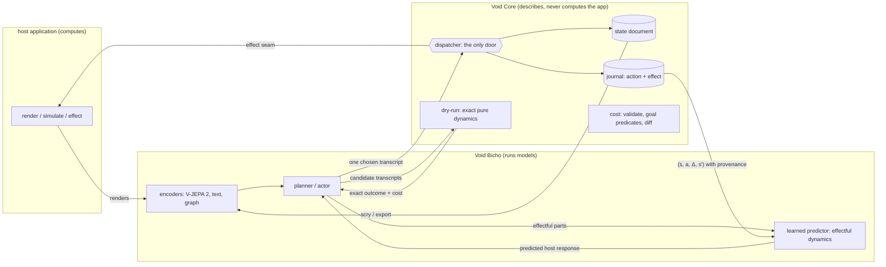

# World models — what Void Core must allow

> **Pillar A of [the transition](/design/the-transition.md)** (ruled 2026-10-30): Void Core's
> optimization target shifts from LLMs toward JEPA-class world models, LLM compatibility kept.
> The direction is decided; the phases below are still each the author's to start.

> The author, 2026-10-28: *"right now void core is hyper optimized for llms, and not other
> kinds of ai models, despite our fundamental architecture being more closely aligned with
> JEPA … I feel like the main battle is with the cli component."*
>
> **Running a model is not Core's job.** It is computing, which the
> [railguard](/design/what-voidcore-is-not.md) keeps out, and acquiring, running and
> accounting for models is Void Bicho's whole charter (`VoidBicho:/design/boundaries.md`).
> This page asks the narrower question the author asked: **what must Core provide so that a
> world model can be attached at all?** Nothing here is built.

---

## 0. The short answer

1. **The intuition is right.** Read against a joint-embedding predictive architecture
   ([LeCun](/sources/lecun-autonomous-machine-intelligence.md)), Void Core already has most of
   the parts, and in two places it has something the JEPA literature has to learn the hard
   way: **object identity across time** (`spirit.id`) and **an action label on every
   change** (the journal).
2. **The CLI is not the incompatibility — the CLI describing itself only in prose is.** A
   command line is a serialization of a typed action. Non-generative encoders consume
   canonical text serializations of graphs well ([ONNX-Net](/sources/onnx-net.md)), and the
   dispatcher-as-only-door is the rule Void Hormiga's clients' data depends on. What a
   non-LLM model cannot do is read *prose*: the action space exists only as the `help`
   string, the effect of a command exists only as `lines`, and a transition exists only as
   a before-image in an undo frame. An LLM can cope with that. A world model cannot.
3. **Core is already a perfect world model of itself.** For every **pure** command (SPEC
   §6.2) the next state is computed exactly by dispatching it into a copy. What Core cannot
   predict is what happens across the **effect boundary** — the host's render, physics,
   audio, a deploy, a person. That is the line where a learned model belongs, and the
   pure-vs-effectful classification already draws it. The right architecture is **hybrid**:
   exact symbolic dynamics from Core, learned dynamics from Bicho, one command language.
4. **What Core should add is small and additive**: the verb catalogue as data, the effect of
   a command as data (which ids it touched), a cheap counterfactual (dry-run), and — already
   held for three other reasons — reified commands with inverses. §6.

---

## 1. JEPA in one page, for this bundle

A **JEPA** encodes two views of the world, `x` and `y`, into representations `s_x` and `s_y`,
and trains a **predictor** to produce `s_y` from `s_x` (plus an action `a`, plus a latent `z`
for what `x` cannot determine). The loss lives in representation space, so the model is never
asked to reconstruct pixels it does not care about. Collapse — everything mapping to one
point — was prevented with EMA teachers and stop-gradients; since 2025 it is prevented by
**SIGReg**, which pushes embeddings toward an isotropic Gaussian and comes with an
identifiability theorem: under stationary additive-noise transitions the latent recovers the
world's true state up to a linear map ([LeJEPA and LeWM](/sources/lejepa-and-leworldmodel.md)).

An **action-conditioned** JEPA is a world model: `ŝ_{t+1} = P(s_t, a_t)`. Planning is
model-predictive control — sample candidate action sequences, roll them through `P`, keep the
one whose predicted end state is closest to the goal's embedding (CEM, MPPI). V-JEPA 2-AC does
this zero-shot on real robot arms ([V-JEPA 2](/sources/v-jepa-2.md)); LeWorldModel does it
from pixels at ~15M parameters; H-JEPA (arXiv 2610.06805) stacks levels that each predict
farther ahead in their own latent, so a top level sets subgoals for the one below.

LeCun's architecture around it has six modules, and they are the frame for §2.

---

## 2. Void Core, laid against the architecture

| AMI module / JEPA part | what it does | in the Void family | status |
|---|---|---|---|
| **perception** | estimate the world's state from signals | [holidays](/concepts/holiday.md) bring data in; Bicho's perception models (SAM, CLIP, …) propose annotations; [Scry](/concepts/scry.md) is the observation function — a pure projection of state into a view | built (host + Bicho side) |
| **state `s`** | the representation that is predicted | a **rune** is the *authored* representation-independent state — the [glyph split](/concepts/glyph.md) already says presentation is "a function from the rune to a modality", which is exactly the encoder's direction reversed | built |
| **views `x`, `y`** | different observations of one thing | `presentations.<modality>` per glyph; renders, sounds, records — one rune, many views | stored, not interpreted |
| **object slots + identity** | which entity is which, across time | runes, with `spirit.id` minted once and **never content-derived** (SPEC §3.1) | built — and the hardest thing for [Slot-JEPA and C-JEPA](/sources/slot-jepa.md) |
| **relations** | how entities stand to each other | `layout.edges` with relation labels and `i:j` port pairs; act runes reify n-ary relations | built |
| **action `a`** | what the agent does | a canonical dispatcher command (SPEC §6.2) | built — but the **action space** is prose (§3) |
| **world model `P`** | predict the next state | **exact** for pure commands (dispatch into a copy); [Reduce](/concepts/reduce.md) and [Temper](/concepts/temper.md) are known rewrite dynamics; **learned** for anything across the effect boundary | exact half built; learned half is Bicho's |
| **cost** | how far from what is wanted | `validate`, tag-expression predicates, `diff` as a structural distance, Void Allomone's constraints | pieces built; not shaped as a cost (§6) |
| **actor** | propose action sequences | anything that writes a transcript — a person, an LLM, Needle, a JEPA planner — reviewed through the §6.1 decoder (`flat`) before dispatch | built (the gate) |
| **short-term memory** | current and predicted states | the state document, the journal, the undo stack | built |
| **configurator** | set the others up for the task | the app manifest, the OKF, `config.transform` | built |

Two things stand out. First, the agent-facing surface was designed for an actor that reads
prose, and nothing else in the table needs prose. Second, the **pure/effectful** line —
introduced for replay and sync — is also the line between *dynamics Core knows exactly* and
*dynamics somebody must learn*. That was not designed; it falls out of "the core does no I/O".

---

## 3. Where the LLM bias actually lives

Measured rather than assumed: the bundle mentions LLMs rarely. The bias is **structural** —
in what is data and what is only text.

| surface | today | what a world model needs | verdict |
|---|---|---|---|
| the one door, `vc_dispatch(string)` | a command line in, an envelope out | a way to submit an action | **keep.** Hormiga's ground rule 3 ("if it can't be replayed headless, its design is wrong") rests on it, and a learned actor's output must pass the same gate as everyone's |
| the action space | the hand-written `help` string; `describe_verbs_test.py` exists because it drifts | the verbs, their argument **types** (ref, field, value, number, tag expression, enum, JSON), and their class (pure/effectful, undo/view slice) **as data** | **gap** — the single most LLM-shaped thing in Core |
| what a command did | `lines` (prose) and often `data: null` for writes | which runes changed — the **effect** | **gap** (Hormiga asked for it as a change feed, 2026-10-25) |
| transitions | the journal records `command`, `verb`, `pure`, `slice`, `minted` — the action, not its effect; undo stores before-images | `(s, a, Δ, s')` tuples | **half there** |
| counterfactuals | `vc_create(export)` copies the whole document | "what would this transcript do?" cheaply and exactly | **gap** |
| typed values | `content` is opaque; [quantity](/concepts/quantity.md) annotations give levels and units for measure runes and glyph fields | numbers an encoder can embed by type | **built in 0.2.14**, and it is exactly the metadata an encoder wants: one-hot nominal, ordered ordinal, differences for interval, logs for ratio |
| `facets` | six free-text strings, "uniform context for a human or LLM" | — | harmless; text encoders use them; leave them |
| POSIX aliases, `describe` altitude, molts | context-window economy for a reader of prose | — | harmless; the journal records canonical lines, which is what a model should train on |
| the reserved `agent …` namespace | "the LLM seam" | a seam for *any* actor | rename the intent, not the verb: it is the actor seam |
| Bicho's capability fragment | `{ "kind": "llm", "ctx": 8192 }` | a model kind that is not a language model | **Bicho's to fix** — flagged, not ours |

So the author's instinct about the CLI is half right, and the half matters. The command
*language* is fine — [HyperWorld](https://arxiv.org/abs/2609.00002) found an entity-centred
textual serialization of state beats triples for small learned world models, which is what
`cat`/`describe` already produce. What is missing is the command language's **schema**, and
its **effects**.

---

## 4. What the papers say a host must get right

Each finding, and what it means here.

**(a) Prediction error does not govern control; plan-cost on reachable states does.**
[You et al.](/sources/control-theory-predictability.md) prove a planner's regret is bounded by
twice the predicted-vs-true cost gap *on the candidates it considers*, and show validation loss
is uncorrelated with success (ρ=0.024). Planners walk off the training manifold into **holes**,
and only counterfactual data or an off-manifold penalty closes them.
→ **Core is a counterfactual-data engine.** For any candidate transcript made of pure
commands, the true outcome is one dispatch into a copy away. This is the family's existing
discipline — Needle's plan validated synthetic rows "by executing them on a live core";
Void Squid's match loop has an injected verifier — named in the literature's terms. The ask
it generates is a cheap **dry-run** (§6, phase 2).

**(b) Closed-loop success hides broken ranking.** [ARC-Bench](/sources/arc-bench.md): on
released JEPA world models the top-ranked candidate is almost always suboptimal, and frequent
replanning masks it.
→ Judge any model attached to a Void host by **fixed-candidate ranking against exact
outcomes**, which Core can compute. A benchmark is a mantle of situations with their
candidate transcripts — the shape Void Squid just proposed to Bicho for its match loop
(`VoidBicho:MESSAGE_FOR_VOIDBICHO_voidsquid-the-match-loop-needs-a-proposer-2026-10-28.md`).

**(c) A snapshot carries configuration, not rate.**
[Frozen in a Frame](/sources/frozen-in-a-frame.md): a single-frame target cannot identify
velocity for any encoder.
→ `vc_export_state` is a snapshot. A model trained on exported documents alone has this
blind spot by construction. Rate lives in **history** (the journal, which needs effects —
§6 phase 1) or in **explicit quantities** (measure runes). An **act** rune is a reified
change: the motion code, written by an author. Open question: should a quantity be able to
say it is the *rate of* another measure? (§8).

**(d) Relations ground through inverse dynamics, not prediction.**
[Inside-JEPA](/sources/inside-jepa.md): pairwise relational channels in the latent become
meaningful only when the model must recover *the action* from how they changed.
→ A mantle is the dataset that paper approximates with bounding boxes: ordered pairs with
typed relations (`layout.edges`) and, with the journal on, the exact action behind every
change. This also raises the stakes of Hormiga's **typed ports at the door** question
(2026-09-22): grounded relations need a relation vocabulary the dispatcher enforces.

**(e) Object-structured interfaces beat dense ones, and correspondence is the hard part.**
[Slot-JEPA and C-JEPA](/sources/slot-jepa.md).
→ **`spirit.id` never content-derived is now load-bearing for a third reason** (after Void
Palabra's conflict-free creation and graph canonicalization). A rune is a slot with free
identity across time. Nothing in this design may weaken it.

**(f) Inputs bound what can be known; prediction targets decide what is kept.**
[What Can Latent World Models Know?](https://arxiv.org/abs/2607.27017): contact stiffness
enters the latent only when touch is *forecast*, not when it is merely an input; a slow
ratio-type parameter (drag) is acquired by no deterministic objective tested.
→ A world-model contract over a mantle must **name its targets** — which glyph kinds, fields
and measure runes the model is asked to predict — not just "the state". Quantity levels are
the annotation that lets a host supervise the slow ratio quantities directly.

**(g) Models are objects in a latent space.** [JEPAWG](/sources/jepawg-bifurcations.md): a
zoo of networks indexed by a physical parameter has a latent geometry whose derivative finds
bifurcations.
→ Bicho's "a model is a rune" is right and goes further than catalogue entries: a model zoo
is a mantle of model runes with measure runes for their parameters. Core needs nothing new.

**(h) A canonical text of a graph is a universal representation.**
[ONNX-Net](/sources/onnx-net.md): an encoder reading `Op(inputs)(params) --> …` predicts the
performance of any ONNX network.
→ Text is not an LLM-only interface (§0.2). And an ONNX graph is itself a net — operators
with ports, tensors as wires — so Bicho could describe a model's *structure* as a mantle, not
only its catalogue entry.

**(i) Hierarchy is how long horizons become tractable.** H-JEPA: each level plans in its own
latent at a coarser stride.
→ A `batch` is a macro-action and its sub-commands are primitives. Void Palabra's standing
ask — record a batch's sub-commands on its journal entry — now has a second consumer.

**(j) JEPA objectives work for language too, with paired views.**
[LLM-JEPA](https://arxiv.org/abs/2509.14252) (text ↔ code); [VL-JEPA](https://arxiv.org/abs/2512.10942).
→ **The LLM path and the JEPA path are not alternatives.** A natural-language intent and the
transcript that realizes it are two views of one action — Needle's training data, exactly —
and an LLM-JEPA objective over that pair is how the command bar gets a latent action space.
That is the "north star" in [context optimization](/design/context-optimization.md) §4, with
a training objective attached.

---

## 5. The architecture: a hybrid world model over one command language

Four rules hold it together, and none is new:

1. **A model proposes; the dispatcher decides.** Bicho's "never truth", Void Squid's "owns no
   truth", Hormiga's rule 3. A planner's output is a transcript and enters through the same
   §6.1 decoder and the same journal as a person's.
2. **Core computes nothing of the application.** It computes *its own* next state for a pure
   command, which it already does on every dispatch. Predicting a render, a trajectory or a
   person is Bicho's.
3. **Embeddings do not enter the state document.** They are large, model-specific and
   derived; Palabra would sync them and every hash would change with the encoder. They live
   beside the data in Bicho's store, keyed by `spirit.id` plus a provenance stamp, and are
   addressed through the planned host `where`-predicate seam
   ([host extension seams](/design/host-extension-seams.md)) when a query needs "near".
4. **No central scheduler, no single device** (Latin-OS's standing constraint). Imagination is
   a fork, forks are independent managers, and independent managers are already thread-safe
   with respect to each other. The other end of a prediction edge may be a remote peer.

---

## 6. What Core should build, in order

Every item is additive, keeps the dispatcher the only write door, and is gated on the author.
Items marked ★ already have another requester, which is the family's bar for building.

**Phase 0 — no code (this page).** Sources in `okf/sources/`; tell Bicho what Core will and
will not provide; leave the `agent …` namespace reserved and re-describe it as the actor seam.

**Phase 1 — the action space and its effects, as data.**
- **A verb catalogue** (`help --json`, or a `verbs` verb): every verb with its arguments'
  types and its classification — mutating, view, rewind, effectful, index-safe. Today four
  hand-kept lists encode that classification (`help`, `is_mutating`, `is_effectful`, and since
  0.2.15 `keeps_ref_index`), so one static table would also delete three ways for them to
  disagree. ★ Needle's tool set; ★ Void Maiz's revision counter, whose source comment says
  *"which verbs mutate is Core's to say and it does not say it"*.
- **The effect on the journal entry**: `touched` — the ids whose content, tags, edges or
  placement changed — beside `minted`. ★ Hormiga's change feed (§4 of their 10-25 message).
  This is the `Δ` in `(s, a, Δ, s')`.
- **`mutated` in the envelope** — a real-change bit derived from the same table. ★ Hormiga, ★ Maiz.

**Phase 2 — a cheap, exact counterfactual.** `batch --dry '<json>'`: run the batch, return
its result plus the `diff` it produced, roll back from the memento it already takes. No new
state, no ABI change, and it is the oracle §4(a) and §4(b) ask for. A host-level `vc_fork`
is the heavier alternative and waits for an ABI release.

**Phase 3 — reified commands with inverses** (held since 2026-06-14,
[command architecture](/design/command-architecture.md)). With an inverse per verb, undo is
O(change), a dry-run is apply-then-invert at O(change) instead of O(slice), and a transition
is a first-class value. ★ Hormiga (one `set` at 10⁵ runes costs 0.48 s in the memento),
★ Void Unity, ★ Void Maiz (`replace_state` has to drop undo history because mementos cannot
survive a merge). World models are the fourth requester.

**Phase 4 — cost as data.** A goal as a tag-expression predicate over runes
(`validate --goal '<expr>'`), and `diff --against <state>` as a structural distance a planner
can minimize. Core already evaluates both pieces; what is missing is a number.

Deliberately **not** proposed: tensors in the state document; a `predict` verb in Core; a
clock or a step counter in Core (time beyond the journal's `seq` is the host's — Scry already
says Core owns transaction time and the host owns the rest).

---

## 7. What must not move

From reading every manifest that names Core (2026-10-28, `mago blast voidcore`: 7 reship,
4 retest) — the contracts a world-model track could break without anyone noticing:

| contract | who depends on it |
|---|---|
| the dispatcher is the only write door; every change replayable headless | Void Hormiga (ground rule 3), Void Reyna (transcript only), every Maiz host |
| the verb vocabulary and its spellings (`set`, `rune new`, `tag`, `setjson`, `link`, `config`, `use` are Hormiga's hot path) | Hormiga, Reyna, VLS, Squid |
| the §6.1 codec law and the canonical command line | every host; Hormiga's submission gate |
| `{ok, lines, data}` and `glyphs`' resolved descriptor | Hormiga, Maiz |
| the state-document shape, round-tripped verbatim (`state.glyphs` included) | Maiz `Session::save`, VLS, Palabra's canonical form and CRDT |
| `spirit.id` random and never content-derived | Palabra (CRDT, canonicalization), and now §4(e) |
| journal entry fields | Palabra |
| exported C symbols — additive only, batched | Void Unity's `VoidAbiAudit` turns red on any unbound export; a future Rust `-sys` crate (Void Jelly's ask) |
| `core/src/*.c` file list | Void Maiz's Android / cross-compile build names Core's sources one by one |
| conformance cases | Unity, Maiz's reduce port, Latin-OS's planned kernel rewriter |
| the Python holidays' signatures | FaultSack (`link: import`) |

---

## 8. Open models worth Bicho's attention

For Bicho to decide; listed because the author asked where to start. Licences checked
2026-10-28 as far as noted, and must be re-checked per checkpoint before anything ships to
Hormiga's clients.

| model | licence | size | fits the 6 GB laptop GPU? | where it would plug in |
|---|---|---|---|---|
| **V-JEPA 2** ViT-L (`facebook/vjepa2-vitl-fpc64-256`, in `transformers`) | MIT | 300M | yes, inference | perception over renders and video — Void Squid's smart logs, Void Onda's "judging motion from its pixels over time" |
| **V-JEPA 2.1** | MIT (third-party report) | ViT-B/L | yes | dense features, segmentation-adjacent |
| **V-JEPA 2-AC** ViT-g | MIT | 1B + 300M | marginal (bf16) | reference only; trained on robot arms |
| **LeWorldModel** via stable-worldmodel | framework MIT; checkpoint licence unverified | ~15–18M | **train it here** | the first world model to *train on Void transitions* (§9) |
| **LeJEPA / SIGReg** (`rbalestr-lab/lejepa`) | see repo | ~50 lines | — | the regularizer for any encoder Bicho trains over mantle state |
| **Causal-JEPA** (`galilai-group/cjepa`) | unverified | small | likely | object-centric: runes are its slots |
| **LLM-JEPA** (`rbalestr-lab/llm-jepa`) | see repo | wraps an LLM | small LLMs | NL intent ↔ transcript as paired views — Needle's data with a JEPA objective |
| **Graph-JEPA / HP-JEPA** | see papers | small | yes | mantle graphs as input |
| **TI-JEPA** | see repo | small | yes | when rate matters (§4c) |
| ~~jepa-wms~~ | **CC-BY-NC** | — | — | non-commercial; not near Hormiga |

---

## 9. The first experiment worth running

**A world model of the dispatcher itself**, before any world model of a host. Take
transitions the core already produces — a Void Reyna or Hormiga-style synthetic dataset
replayed with the journal on — encode each mantle state with a small rune-centred encoder
(SIGReg-regularized), embed each canonical command, and train a LeWM-sized predictor of the
next latent. Evaluate it ARC-Bench-style: for a fixed set of candidate transcripts, rank them
by predicted distance to a goal state and compare against the **exact** ranking Core computes
by dry-running every candidate.

Why first: ground truth is free and exact, so every failure is the model's and none is the
data's; it exercises every Core change in §6 phases 1–2 and nothing else; and it answers the
question this page cannot — whether the mantle representation is a good latent target at all
— before anyone builds against it. If a JEPA cannot learn the dynamics of a system whose rules
fit in about 5 500 lines of hand-written C, it will not learn a host's.

---

## 10. Open questions (for a grilling session)

1. **The split** (Hormiga, 2026-09-23). A world model needs only *read* and *propose*; the
   read half could be a library a small device links without the command language. Hormiga's
   lean — the pure half read-only, every change through the dispatcher — is the shape this
   page wants too. Decide whether to build it, not whether it is safe.
2. **Rate quantities.** Should a quantity annotation be able to say "rate of `<measure>`"?
   §4(c) argues eventually; units already make `m/s` expressible as a label.
3. **Where embeddings are addressable.** Through host `where`-predicates only, or a declared
   `presentations.latent` per glyph naming which encoder speaks for it?
4. **The actor seam's name.** Keep `agent …` reserved, or name what it is — every actor,
   human-written transcript included, already enters there.
5. **Who owns the benchmark format** — a mantle of situations with candidate transcripts and
   exact outcomes. Core (it is conformance-shaped) or Bicho (it is model-shaped)?

---

## Further reading

Beyond the pages in `okf/sources/`: H-JEPA (arXiv 2610.06805), What Can Latent World Models
Know? (2607.27017), Latent State Design under Sufficiency Constraints (2605.01694),
BeliefGraph-JEPA (2610.05409), HyperWorld (2609.00002), Do Neurons Dream of Primitive
Operators? (2603.25975 — compression rediscovers Schank's event primitives from before/after
state pairs, which is what rune kinds and verbs are), stable-worldmodel (2602.08968),
EB-JEPA (2602.03604), jepa-wms (2512.24497), VL-JEPA (2512.10942), LLM-JEPA (2509.14252).
